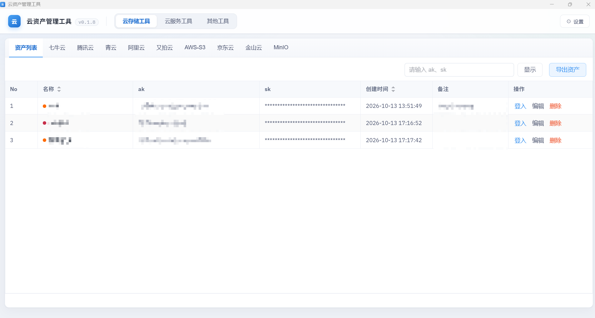
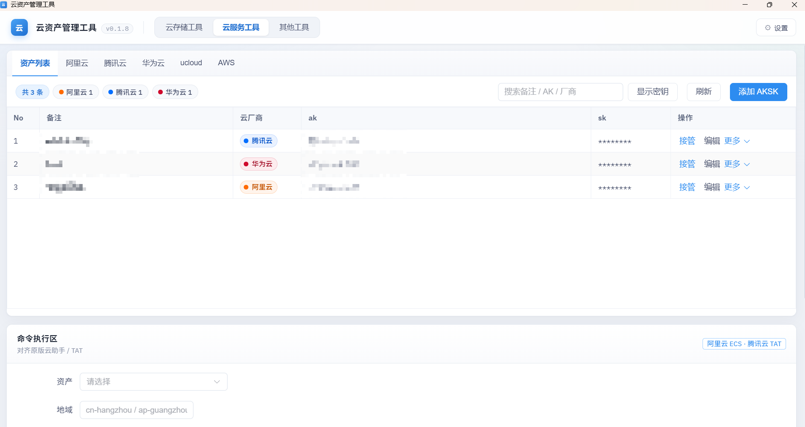
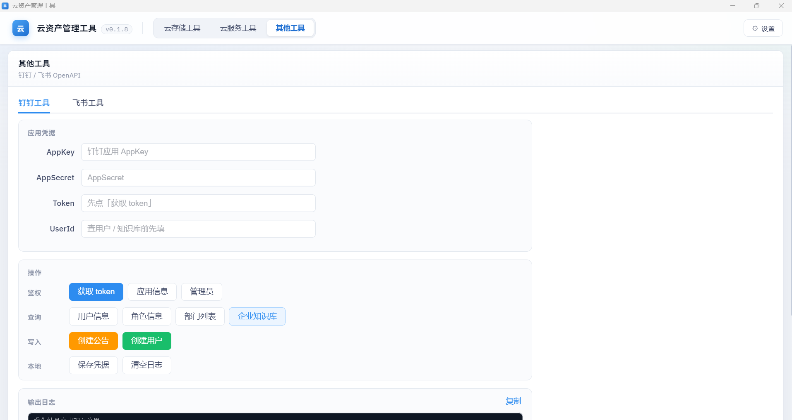

# Cloud Asset Hub · 云资产管理工具

## 免责声明

Cloud Asset Hub 仅供安全与运维人员在**已获授权**的云账号上进行检测、运维与安全评估。未经授权，不得使用本工具对任何系统实施未授权访问或破坏性操作。因使用本工具所产生的直接或间接后果，由使用者自行承担。

请遵守相关法律法规及云服务商协议。

## 项目亮点

相对常见云资产小工具（含原版 king-akmanage 一类实现），本仓库补齐了原版缺失或做得不完整的能力，重点如下：

| 亮点 | 说明 |
|------|------|
| **批量 / 一键关闭安全告警** | 原版多为单条处理；本版支持多选批量 `HandleSecurityEvents`，以及分页拉取后**一键关闭全部未处理告警**（默认 `ignore`，可改操作码） |
| **批量告警通知配置** | 支持按通知类型批量改 Route / TimeLimit（含一键静默），不必逐条点开修改 |
| **资产列表主机明细** | 阿里云 / 腾讯云 AK 行可展开查看全地域主机；结果本地缓存，再次展开不重拉；支持刷新与并行拉取 |
| 多云一体桌面端 | 云存储 + 云服务（AK/SK、接管、RDS、远程命令）+ AI Key 盘点 + 钉钉/飞书，一套 Electron 应用 |
| Windows 正式分发 | 提供 NSIS 安装包与绿色便携版，开箱即用 |

> 阿里云告警能力基于安全中心 SAS/TDS（`DescribeSuspEvents` / `HandleSecurityEvents` / `ModifyNoticeConfig`），仅对已授权账号使用。

## 介绍

云安全向桌面工具，主要包含：

- **云存储工具**：对象存储资产接入，文件查看、上传、下载、删除、预览、目录管理等
- **云服务工具**：多云 AK/SK 管理，控制台接管，子用户查看，以及阿里云 RDS / 告警 / 远程命令等
- **云AI密钥**：自定义 AI Key 资产（常见模板快捷填入），验证可用性与试调
- **其他工具**：钉钉 / 飞书 OpenAPI（鉴权、查询、写入等）

## 软件架构

Electron + Vue 3 + Element Plus + Node.js

## 目前实现功能

| 云厂商 | 能力 |
|--------|------|
| 阿里云 | 控制台接管 / 取消接管、对象存储、远程命令回显、子用户列表、云数据库（RDS）、**安全告警批量处理 / 一键关闭**、告警通知批量配置 |
| 腾讯云 | 控制台接管 / 取消接管、对象存储、远程命令、子用户列表、域名列表 |
| 华为云 | 控制台接管 / 取消接管、子用户列表 |
| ucloud | 控制台接管 / 取消接管、子用户 / 主用户、订单查看 |
| AWS | 控制台接管、子用户列表、策略列表、IAM 密钥相关能力 |

## 云存储工具

支持厂商：七牛云、腾讯云 COS、青云 QingStor、阿里云 OSS、又拍云、AWS S3、京东云、金山云 KS3、MinIO。

常见能力：资产列表、存储桶浏览、上传 / 下载 / 删除 / 移动 / 预览、创建目录、分页；部分厂商支持自定义域名、CDN 刷新、图床样式等。

### 云存储工具 · 资产列表

## 云服务工具

- 资产列表：多云 AK/SK 增删改查、别名 / 笔记、本地持久化、导出；**阿里云 / 腾讯云可展开主机明细**（缓存 + 并行地域拉取）
- 控制台接管 / 取消接管 / 接管记录
- 子用户列表（按厂商能力）
- 阿里云：
  - **告警处理**：列表查询、单条 / **多选批量处理**、**一键关闭全部告警**
  - **告警通知配置**：单条修改 + **批量修改 / 一键静默**
  - RDS 管理、ECS 远程命令（主机表选目标）
- 腾讯云：远程命令、域名列表、主机明细
- AWS：策略列表、IAM / 后门用户相关操作
- ucloud：订单等信息查询

### 云服务工具 · 资产列表与命令执行

## 云AI密钥

- 定位：盘点 / 验证挖掘到的 AI Key 是否可用（自定义名称 + Base URL + Key）
- 常见模板快捷填入：自定义、OpenAI、阿里云百炼、DeepSeek、Moonshot、硅基流动、Ollama
- 底层统一 OpenAI Compatible；导入 / 导出 JSON；探测状态落库；试调可取消

## 其他工具

钉钉 / 飞书 OpenAPI：应用凭据、获取 token、用户 / 角色 / 部门 / 知识库查询，以及公告、用户写入等操作。

### 其他工具 · 钉钉

## 下载

请到 [Releases](https://github.com/yz0x1/cloud-asset-hub/releases) 下载最新 Windows 安装包 / 便携版。

## License

[MIT](LICENSE) © yz0x1
